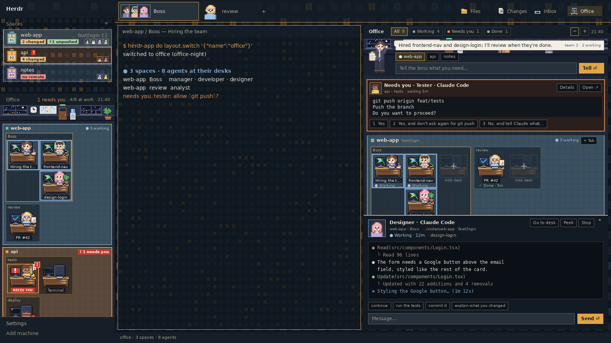

# Office

An office-toned Herdr layout. Every space is a project, every agent a member of
staff at their own desk in one shared office: you see who is typing, who needs
you and who dozed off, and one click takes you to their terminal.



Derived from [herdr-traveler](https://github.com/franky5440-afk/herdr-traveler)
(Apache 2.0, Copyright 2026 Frank Lin): same node tree and same mod structure,
rethemed from a pixel RPG to a modern office and renamed throughout. See
`NOTICE`.

## Install

```sh
H=~/.config/herdr-app
cp layouts/office.* "$H/layouts/"
cp themes/office-night.json "$H/themes/"
cp -R mods/* "$H/mods/"
herdr-app do layout.switch '{"name":"office"}'
```

The Changes panel is [Git Changes](https://github.com/aBER0724/herdr-git-changes)
(MIT), not the one Herdr ships, so install that mod too:

```sh
git clone https://github.com/aBER0724/herdr-git-changes
cp -R herdr-git-changes/mods/git-changes "$H/mods/"
```

`herdr-app check` must pass for every mod before you switch. Never overwrite your
own files — rename first if you already have a mod or theme called `office-*`.

Updating overwrites `mods/office-agents/jobs.json`. Back it up first and put it
back, or update without it:

```sh
H=~/.config/herdr-app
rsync -a --exclude jobs.json mods/ "$H/mods/"
```

Earlier versions shipped `mods/office-agents/sprites/`, `mods/office-spaces/art/`,
`mods/office-spaces/places.json`, `mods/office-chrome/sidebar.png` and
`mods/office-chrome/floor.png`; nothing reads them any more, so delete them from
`$H/mods` after updating, and copy `layouts/office.json` again.

Uninstall:

```sh
H=~/.config/herdr-app
herdr-app do layout.switch '{"name":"main"}'
rm -rf "$H"/mods/office-agents "$H"/mods/office-chrome "$H"/mods/office-spaces \
       "$H"/mods/office-tabs "$H"/mods/office-inbox
rm -rf "$H"/data/office-agents "$H"/data/office-chrome "$H"/data/office-spaces \
       "$H"/data/office-tabs "$H"/data/office "$H"/data/office-inbox
rm -f "$H"/layouts/office.json "$H"/layouts/office.png "$H"/themes/office-night.json
```

This deletes everything in the inbox folder; move anything you want to keep
first. Herdr keeps the mod names in its own `seen.json`, which is harmless.

## What you see

- **Theme `office-night`:** ink blue background `#101820`, panel `#1b252f`,
  amber accent `#e0a44a`, paper text `#e6dfd2`, muted steel `#5f8fa8`. Square
  corners with thin amber frames.
- **One backdrop everywhere:** night office windows, a few lit by a lamp or a
  screen, `mods/office-chrome/wallpaper.png` (`cover`). It is the `background`
  of the sidebar, the work column (behind the translucent tab bar and between
  the panes), the side panel and every pane, where the terminal draws over it at
  the root `terminal_opacity` of `0.62`.
- **Sidebar, 300 px**, two parts (weights 0.62 and 1.38):
  - **Spaces:** a 44 px row per space. A 28 px project folder in the space's
    colour with its initial, the name, the branch when unusual, then one line:
    uncommitted files (`ansi3`), unpushed commits (`ansi2`), repos without a
    remote (`ansi1`), and a dot per agent in the space in its status colour.
    A space where an agent works **breathes**: a steady frame in the working
    colour over a glow that fades in and out. A space where an agent waits for
    you **blinks** a thick orange frame over a red tint, with a `!` by its name.
    Waiting wins over working.
  - **Office:** a header (`N need you`, `N/M at work`, the time), the back wall
    (night windows, clock, kanban board, door, water cooler, plant), then the
    dark carpet. Each **space is a rug** tinted in its folder's colour, in the
    Spaces order. On it each **tab is a cubicle** with its name (amber for the
    tab you are on). In it each **pane is a desk, placed the way the tab is
    split**: panes split right sit side by side, panes split down sit one above
    the other, so a tab split right and then down on the right shows one desk
    on the left and two stacked on the right. A pane with an agent has
    its staff member (a pastel chibi) behind the desk facing you, the monitor beside them showing
    the state; any other pane is an empty desk with the screen off, labelled
    `Terminal` for a shell (never the long `user@host:path` title) or its
    program's name. A sub-agent without a pane of its own takes an extra desk at
    the end of its tab. Put-away tabs stay out unless someone in them needs you.
- **Tabs, 58 px:** square 48 px tabs showing **every agent in the tab**: one
  agent as a 44 px portrait, several as overlapping faces framed in their status
  colour (four at most, then `+n`), then a terminal mark with the count of the
  tab's other panes. Faces match the desks in the office. Files, Changes and
  Inbox buttons open the right panel.

Herdr's mod API gives a tab's panes in order but not where a split put them.
The office reads that from Herdr's own layout document, which herdr-core keeps
in `~/.local/state/herdr-core/default/docs.json` (on a remote machine, the same
path in its home): read only, again whenever a tab's panes change. It looks for
the part of the document that names the tab's panes and follows its splits down
by their direction words (`right`/`row`/`horizontal`, `down`/`column`/
`vertical`). When it can't tell (another `HC_SESSION` or `XDG_STATE_HOME`, a
document it doesn't understand, or a split more than three desks wide), the
desks fall back to pane order: up to three in a row, four as two by two.

### At the desk

| Status | Screen | Staff |
|---|---|---|
| `working` | green, code scrolling fast, LED green | typing fast (a key every 90 ms), eyes on the screen, coffee steaming; the desk breathes: a bright frame, a glow and a wider ring fading in and out |
| `blocked` | red, blinking `!` | one hand up, mouth open, a `!` bubble; a thick orange frame blinks over a red tint, a `!` badge bobs on the corner, the label turns into a red `NEEDS YOU` tag |
| `done` | blue with a check mark | stretching, hands behind the head, smiling |
| `idle` | screensaver | head down on folded arms, `zZz` |

Every desk is lit by its screen, and each role keeps its own things on it (a
plant, a rubber duck, a phone, a chart, a stack of books...). A rug shows its
space the same way (breathing or blinking) with `● N working` or
`! N need you` in its corner. The pulses are native `loop`s on `opacity`/`top`:
they run without re-rendering the mod. Click a staffed desk for
`agent.focus` (its terminal, in its space and tab); click an empty one to go to
that pane. Hover for who, what and where. `agent.next` / `agent.prev` walk the
desks in the order they are drawn. Narrowed below 160 px, the office becomes a
column of faces framed in their status colour.

## Customize

- **Who is who:** `mods/office-agents/jobs.json` maps a tab name to a role.
  Roles: `manager`, `developer`, `designer`, `analyst`, `writer`, `tester`,
  `support`, `intern`. A tab's first agent wears the tab's role and the other
  agents in that tab get roles of their own, so faces repeat only past eight.
  The tab bar and the office work this out the same way (`tabDesks`,
  `deskJobs`). Copy the file to every machine to get the same faces everywhere.
- **Project colours** come from the Spaces list (`space.colors`), so the folder
  and the rug of a space always match.
- **Art:** drawn by `tools/build-art.py`; `tools/build-preview.py` composes the
  mock `preview.png` and the picker thumbnail from it. Prompts for model-made
  replacements are in `docs/ART-PROMPTS.md`.
- **Sounds:** none included. Put MP3s in `~/.config/herdr-app/sounds/` and add
  `"sounds": { "enabled": true, "done": "sounds/done.mp3", "blocked": "sounds/blocked.mp3" }`
  to `settings.json`.

## What it does on your machine

- `office-spaces` runs `git status`, `git rev-parse` and `hc machine ls` itself,
  in every folder that has a terminal. On connected remote machines Herdr runs
  that `git` there.
- `office-agents` reads its own `jobs.json` and herdr-core's `docs.json` (for
  the splits; it writes nothing and shows nothing else from it).
- `office-inbox` runs `mkdir`, `find`, `stat` and `open`.
- No mod opens a network connection of its own or reads credentials.
- **Do not open a terminal inside a repo you do not trust.** `git status` can run
  filters from that repo's own `.git/config`. The status call keeps
  `safe.bareRepository=explicit`, which blocks bare repos hidden inside a clone,
  but it cannot stop filters in the repo's own config.

## Art and license

Code is Apache 2.0, see `LICENSE` and `NOTICE`. `office-spaces`, `office-tabs`
and `office-chrome` are modified copies of Herdr's built-in `spaces`, `tabs` and
`workspace-chrome` (Herdr 0.1.11), as are the upstream mods they derive from.

The office idea — one room, a desk per agent, the screen telling its state — is
inspired by [herdr-office-layout](https://github.com/zuccs/herdr-office-layout)
and [Sit & Watch](https://github.com/funny-it-worked-last-time-gsv/herdr-sit-and-watch-layout)
(both MIT). No code or art is copied from them.

The images in this repo are **generated by `tools/build-art.py`** — drawn pixel
by pixel in code, no image model — so they carry the same Apache 2.0 license as
the code. Art you generate from `docs/ART-PROMPTS.md` with a hosted model is
yours to license; the prompts grant nothing and make no warranty.
