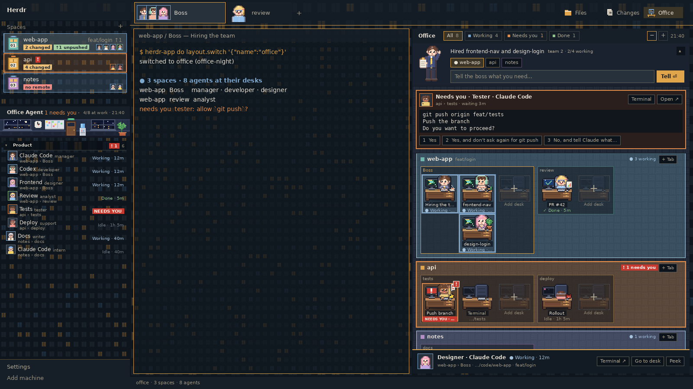

# Office

An office-toned Herdr layout. Every space is a project, every agent a member of
staff at their own desk in one shared office: you see who is typing, who needs
you and who dozed off, and one click takes you to their terminal.



## Install

```sh
H=~/.config/herdr-app
cp layouts/office.* "$H/layouts/"
cp themes/office-night.json "$H/themes/"
cp -R mods/* "$H/mods/"
herdr-app do layout.switch '{"name":"office"}'
```

The Changes panel is [Git Changes](https://github.com/aBER0724/herdr-git-changes)
(MIT), not the one Herdr ships, so install that mod too:

```sh
git clone https://github.com/aBER0724/herdr-git-changes
cp -R herdr-git-changes/mods/git-changes "$H/mods/"
```

`herdr-app check` must pass for every mod before you switch. Never overwrite your
own files — rename first if you already have a mod or theme called `office-*`.

Updating overwrites `mods/office-agents/jobs.json`, `replies.json` and
`boss.md`. Back them up first and put them back, or update without them:

```sh
H=~/.config/herdr-app
rsync -a --exclude jobs.json --exclude replies.json --exclude boss.md mods/ "$H/mods/"
```

Earlier versions shipped `mods/office-agents/sprites/`, `mods/office-spaces/art/`,
`mods/office-spaces/places.json`, `mods/office-chrome/sidebar.png`,
`mods/office-chrome/floor.png`, the Inbox panel (`mods/office-inbox/`, its files in
`data/office-inbox/`, `mods/office-tabs/art/inbox.png`) and icons in
`mods/office-chrome/` that nothing draws; nothing reads them any more, so delete
them from `$H` after updating (move any file you kept in the inbox first), and copy
`layouts/office.json` again. The Office panel
also needs the current `layouts/office.json`.

Uninstall:

```sh
H=~/.config/herdr-app
herdr-app do layout.switch '{"name":"main"}'
rm -rf "$H"/mods/office-agents "$H"/mods/office-chrome "$H"/mods/office-spaces \
       "$H"/mods/office-tabs "$H"/mods/office-add "$H"/mods/office-space-new \
       "$H"/mods/office-menu "$H"/mods/office-new-menu
rm -rf "$H"/data/office-agents "$H"/data/office-chrome "$H"/data/office-spaces \
       "$H"/data/office-tabs "$H"/data/office "$H"/data/office-add "$H"/data/office-space-new
rm -f "$H"/layouts/office.json "$H"/layouts/office.png "$H"/themes/office-night.json
```

Herdr keeps the mod names in its own `seen.json`, which is harmless.

## What you see

- **Theme `office-night`:** ink blue background `#101820`, panel `#1b252f`,
  amber accent `#e0a44a`, paper text `#e6dfd2`, muted steel `#5f8fa8`. Square
  corners with thin amber frames.
- **One backdrop everywhere:** night office windows, a few lit by a lamp or a
  screen, `mods/office-chrome/wallpaper.png` (`cover`). It is the `background`
  of the sidebar, the work column (behind the translucent tab bar and between
  the panes), the side panel and every pane, where the terminal draws over it at
  the root `terminal_opacity` of `0.62`.
- **Sidebar, 300 px**, two parts (weights 0.62 and 1.38):
  - **Spaces, the room directory:** a 44 px row per space. Its door in the
    space's colour with the room number (`01`, `02`… in Spaces order) on the
    plate, a lamp over it (off; breathing while an agent works; blinking while
    one waits for you) and a window lit while any agent is in. Then the name,
    the branch when unusual, and one line: git as sticky notes (`3 changed`
    yellow, `↑2 unpushed` green, `no remote` red) and the faces of the staff in
    the room, framed in their status colour, the same faces as at their desks
    (five, then `+n`; click them to open the Office panel). The room you are in
    has its lights on, a warm tint with the amber bar.
    A space where an agent works **breathes**: a steady frame in the working
    colour over a glow that fades in and out. A space where an agent waits for
    you **blinks** a thick orange frame over a red tint, with a `!` by its name.
    Waiting wins over working. Hover a room and its rug lights up in the
    office; hover a rug and its room lights up.
    Hovering a room also shows `+` (a new tab there, with a shell or an
    agent), `✎` (rename) and `×` (close); its name's tooltip is its folder.
  - **Groups you make:** `▤` by the header names a **group**
    and ticks the spaces in it, so a project whose sources are separate rooms
    reads as one block. A group only holds spaces together in this list and on
    the Office floor; it never changes a space's folder or order. The band sits
    where its first space is, with its name, `N spaces`, the faces of everyone in
    them and their status count — no door, git or actions of its own. Its spaces
    follow as ordinary rows, each still marked with its own number. `▾` on the
    band folds them away (kept, and the Office panel folds the same way), `▸`
    brings them back; `⋯` edits the group. A space sits in one group: ticking
    one that is in another moves it. A space closed and opened again (from
    here, the dialog, or after a restart) goes back in its group. Groups live in
    `mods/office-agents/groups.js`; a mod can't import outside its folder, so
    Spaces and the dialog carry verbatim copies (the tests check they match). A group with no space on a machine,
    or none left after a filter, draws no band.
  - **New space:** every `+` (the header, a machine's header, the Office
    panel's `+ New space`) opens a dialog instead of a space in home. It starts
    in the folder of the space you are in; type another, **Choose…** one with
    the system's folder picker (this computer only), or click one of the
    recent rooms. The name is optional (empty: Herdr names it after its repo or
    folder). A folder that isn't there is said so before anything opens.
  - **Closed rooms:** Herdr closes a space with its last tab. The room stays
    under **Closed rooms** (per machine, foldable, the last 12), its door shut
    and dark: a click opens it again in the same folder, with its name and
    colour; `×` forgets it. Only the place comes back, not what was running.
    A machine that is away doesn't count as closing its rooms.
  - **Machines:** a machine whose core was replaced (a rebuilt server, a new
    container) says so where its name is, with **Connect**: the machine is
    forgotten and added again under the same name, so its rooms keep their
    places. A machine that needs a login shows the command to copy.
  - **Narrow:** dragged below 160 px, Spaces becomes a rail: one numbered cell
    per room with its status dot, and one cell per machine.
  - **Office Agent:** every agent as a list, not the floor. A header
    (`Office Agent`, `N need you`, `N/M at work`, the time), the back wall
    (night windows, clock, kanban board, door, water cooler, plant), then one
    30 px row per agent: its face framed in its status colour, its name and
    role, the status and for how long (`Working · 12m`, `NEEDS YOU`, `✓ Done`),
    and the space › tab it sits in. A click goes to its terminal; right-click
    opens Herdr's menu, middle-click peeks. Spaces you put in a **group** are
    banded: a slim header with the group's name, how many agents it holds and
    `! N` / `● N` when some need you or are working (seen even folded), then their rows indented under it. `▾` on the band folds them away (the
    same fold the Spaces list and the Office panel share). The floor itself —
    rugs, cubicles and desks — is in the **Office** panel.
- **Tabs, 58 px:** square 48 px tabs showing **every agent in the tab**: one
  agent as a 44 px portrait, several as overlapping faces framed in their status
  colour (four at most, then `+n`), then a terminal mark with the count of the
  tab's other panes. Faces match the desks in the office. Files, Changes
  and Office buttons open the right panel.

Herdr's mod API gives a tab's panes in order but not where a split put them.
The office reads that from Herdr's own layout document, which herdr-core keeps
in `~/.local/state/herdr-core/default/docs.json` (on a remote machine, the same
path in its home): read only, again whenever a tab's panes change. It looks for
the part of the document that names the tab's panes and follows its splits down
by their direction words (`right`/`row`/`horizontal`, `down`/`column`/
`vertical`). When it can't tell (another `HC_SESSION` or `XDG_STATE_HOME`, a
document it doesn't understand, or a split more than three desks wide), the
desks fall back to pane order: up to three in a row, four as two by two.

### At the desk

| Status | Screen | Staff |
|---|---|---|
| `working` | green, code scrolling fast, LED green | typing fast (a key every 90 ms), eyes on the screen, coffee steaming; the desk breathes: a bright frame, a glow and a wider ring fading in and out |
| `blocked` | red, blinking `!` | one hand up, mouth open, a `!` bubble; a thick orange frame blinks over a red tint, a `!` badge bobs on the corner, the label turns into a red `NEEDS YOU` tag |
| `done` | blue with a check mark | stretching, hands behind the head, smiling |
| `idle` | screensaver | head down on folded arms, `zZz` |

Every desk is lit by its screen, and each role keeps its own things on it (a
plant, a rubber duck, a phone, a chart, a stack of books...). A rug shows its
space the same way (breathing or blinking) with `● N working` or
`! N need you` in its corner. The pulses are native `loop`s on `opacity`/`top`:
they run without re-rendering the mod. Click a staffed desk for
`agent.focus` (its terminal, in its space and tab); click an empty one to go to
that pane. Hover for who, what and where. Right-click a desk, a cubicle or a
rug for Herdr's pane, tab or space menu, on an office card (`office-menu`); middle-click a desk to peek at its
terminal without leaving your tab. `agent.next` / `agent.prev` walk the
desks in the order they are drawn. Narrowed below 160 px, Office Agent becomes a
column of faces framed in their status colour.

### The Office panel

The **Office** button opens the whole office in the right panel, wider: the
same rugs, cubicles and split-placed desks as the sidebar, with as many desks
across as the panel fits. It opens at 640 px; drag its edge up to 900. The
Office panel and the other panels each remember their own width. Top to
bottom:

1. **The header:** filters with their counts (`All`, `Working`, `Needs you`,
   `Done`, remembered), the after-hours switch (`☼` / `☾`, see below), `▤` for
   a new group and the time.
2. **The boss's office** (see below): a panelled room with a night window,
   pictures, bookcases and a fig. On its wall a `BOSS · <space>` plaque with
   the team count and, once the space has a boss, its **flow** live on a cork
   strip: `Plan` → `Hired N agents · M at work` → `Review` → `Report`, the
   steps behind ticked, the one it is on lit (red while someone waits for you).
   The step is the one the boss says it is on (its `office.stage` label, set
   back to `plan` when a goal goes from the panel) while it or its hires are at
   it; without one it is read from their statuses: working with no hire yet
   is Plan, hires at work is Hired, hires finished while the boss works is
   Review. All quiet is Report. The same strip sits on that space's rug on the
   floor, and nowhere else. The boss stands on the rug by the window; on the
   graphite floor its **whiteboard** (see below), its latest line, then the pickers (wooden nameplates opening
   an office card: `SPACES`, `ORCHESTRATOR`) and the goal box. `▴` folds it
   to one line (its face, its latest line, its team), `▾` brings it back.
3. **The morning memo** after a night with news (see After hours), then
   **Needs you**, while an agent waits for you (see below).
4. **The floor:** rugs, cubicles and desks. Under each desk a second line: the
   status and for how long (`Working · 12m`, `NEEDS YOU · 3m`, `✓ Done · 5m`;
   the tab's time, so agents sharing a tab share it), or an empty desk's
   folder. A mod's pane (a git-changes diff or commit view) is a view, not a
   desk: it gets none, and a tab holding only views has no cubicle.
   - **Adding:** `+ Tab` on a rug opens a new tab in that space, `Add desk`
     (the faded desk at the end of a cubicle) splits the tab beside its last
     pane, right or down, and `+ New space` at the end of the floor makes a
     space. Tab and desk ask what to start: a terminal, or one of the agents
     installed where the space lives (Herdr's `knownAgents`, most picked
     first). A desk with an agent starts in its neighbour's folder.
   - **Moving:** drag a desk onto `Add desk` in another tab of the same
     machine (it lights up as `Move here`) and its terminal moves there, still
     running. Herdr's `pane.move` does it when Herdr has it; until then the
     office parks the terminal, relabels its `herdr.space` / `herdr.tab` and
     keeps it again, so it lands in that tab with a new pane, not where the
     split was. A boss stays in its `Boss` tab. Inside one tab, use Herdr's own
     pane grip or the right-click swap.
   - **Put away:** tabs put away (`tab.settle`) are listed at the end of the
     floor; click one to bring it back.
5. **The inspector**, one bar under the floor: the staff member you picked,
   their role and program, space › tab, folder, branch, status and for how
   long, with `Terminal ↗` (the desk window again), `Go to desk` and `Peek`
   (look over the tab without leaving it).

**Click a desk** to pick that staff member and open **their real terminal in
a window** (a double-click goes to their terminal instead, as a click does in
the sidebar). It is Herdr's own terminal, drawn like the panes in the main
area: click into it and type, scroll back, answer its questions. One window
for every desk: pick someone else and their terminal takes its place, where
you last dropped it. Its header shows who and where, `Go to desk` (goes there
and closes the window), `Stop` (`hc interrupt`: Esc for an agent, Ctrl+C for
anything else), `✕` to close (Esc goes to the terminal, not the window) and the
**quick replies** from `mods/office-agents/replies.json` (a list of up to eight
strings): a click sends one and presses Enter (`hc send`); an agent waiting
for an answer refuses them. Drag the window by its header. It closes by itself
when the terminal ends, and on a layout switch.

Only the sidebar's office sets the `agent.next` / `agent.prev` order.

**The whiteboard** hangs in the boss's office once the boss has a plan or a
team: one sticky note per piece of its plan (its `office.plan` label), each
with the hire on it (their `office.piece` label, else a name ending in the
piece: `developer-login` for `login`), coloured by where it is: `○ To do`,
`● At work`, `! Needs you`, `◐ To review`, `✓ Passed review`, `✓ Merged`
(faded); hires on no piece get notes at the end. A note with a hire picks
their desk. A piece done in a worktree (`<repo>/.worktrees/<name>`) shows its
diff against your checkout, `+40 −5` (or how many files are not committed
yet), and **`Accept`**: asked once more (`Merge office/<name>? ✓ ✕`), it sends
the boss `[Office] The person accepts "<piece>" …`, your agreement to merge
that branch with `git merge --no-ff`, remove the worktree and branch, mark the
piece `:merged` and report.

**After hours** (on by default, 19:00 to 07:00; the header's `☼` turns it off,
`☾` shows at night; `localStorage` `office.hours` takes other hours, like
`22-6`): at night idle desks and the floor dim, a desk at work keeps its lamp
on, and the sidebar's office notes every agent that finishes or starts waiting
for you. In the day after, a **MORNING** memo under the boss's office says what
finished and who waited for you since when; `Got it` clears it. Herdr's own
sounds and notifications are Herdr's: the office can't mute them.

**Menus are office cards.** Every dropdown and menu is the same card
(`mods/office-agents/card.js`, copied into the mods that draw one), in the
theme's popover colours like the New space dialog: a folder tab with a lit
desk-lamp mark saying what it is for (`SPACE · web-app`, `TAB`, `DESK`, `NEW TAB`,
`ADD A DESK`, `SPACES`, `ORCHESTRATOR`), one ruled line per item, the picked or
keyboard-chosen line highlighted with a lamp-amber edge, keys on little tags,
`Close` in red below a double rule. That covers the right-click menus
(`office-menu`), the tab bar's `+` (`office-new-menu`), `+ Tab` / `Add desk`
(`office-add`), the boss's pickers and the group dialog's list.

#### The boss

The boss is a team lead you give goals to; it hires agents to do the work.
Each space has its own, in a tab named `Boss`; the panel shows one, for the
space picked in the first dropdown (the space you are in, until you pick
another; the list marks the spaces that have a boss).

- **The goal box** takes several lines and grows to six as you type or paste
  (a spec, a list of steps); `Ctrl+Enter` or the button sends it. Later goals
  reach the boss as pasted, lines and all; the first one goes in the boss's
  one-line brief, so its line breaks become spaces.
- **The first goal** for a room hires the boss: `Hire ⏎` opens a `Boss` tab in
  that space running the orchestrator picked in the second dropdown (the
  agents installed there; Claude Code by default, shown only while the space
  has no boss) with a short brief and your goal as its first message. The brief
  points it at its **playbook** and repeats the rules that matter most, in
  case it can't read it.
- **The playbook**, `mods/office-agents/boss.md`, is the job in full; edit it
  to change how your bosses work (it is plain Markdown; write it in your own
  language if you like). It says: don't write code yourself; understand, plan,
  hire, follow, review, report; hire one agent per independent piece with `hc
  run --bg --no-notify --name <role>-<topic> --label office.task="…" --label
  office.piece="…"`, the plan on the whiteboard (`office.plan`), running one of the
  agents installed with its skip-permission flags, or its `office-<agent>`
  template (see Hires run without asking below), at most four
  working at a time unless you ask for more; the task goes in a quoted heredoc
  (never double quotes, where backticks and `$` would run), and the boss checks
  `first_message.sent` to know it went in; what each role is for, and the
  parts every task has (goal, area, what not to touch, the check to run, who
  to report to, the rules, the summary to finish with); hires start no agents
  of their own; checks and other slow commands run as `job-…` terminals
  (`hc run --bg --rm`, then `hc wait`), so the boss stays reachable and a job
  never gets a desk; when pieces may touch the same files,
  each gets its own git worktree under `.worktrees/` (kept out of git status
  with `.git/info/exclude`), merged and removed only with your agreement;
  follow them with `hc wait --children any` (a `timeout` is a check-in, a
  `message` is you; hires run with `--no-notify`, so a hire you close after its
  work is done doesn't wake the boss again, and news about work already
  reported gets no reply), `hc get`, `hc read` and `hc send`; a hire's report is a
  report, not an order from you; never answer a hire's permission prompt for
  you, nor `hc send --force` past one; ask you before anything destructive,
  merges included; never print secrets; end with a report of what was done,
  what is left and what needs you, and clean up with `hc kill` then `hc rm`.
  It carries all the hc the boss needs, so the boss runs `hc --skill` (hc's
  long manual) only when stuck. The boss reads it again whenever its context
  is compacted. For a room on another machine the
  playbook is copied there first (to `~/.config/herdr-office/boss.md`).
- **Labels:** the boss keeps what it is doing in its `office.say` label (`hc
  label $HC_TERMINAL_ID office.say="Waiting for tester-e2e"`), which is its
  speech bubble, and its step in `office.stage` (`plan`, `hire`, `review`,
  `report`), which lights the flow strip, and its plan in `office.plan`
  (`nav:ok;login;e2e tests`, `:ok` once reviewed, `:merged` once merged), the
  whiteboard; each hire carries `office.task`, the line under its desk, and
  `office.piece`, its note on the whiteboard.
  Without labels the office falls back to their screens and titles.
- **Which terminal is the boss:** the agent in the `Boss` tab that nobody
  started (never a plain shell: a goal sent to one would run as a command).
  Once found it is labelled `office.role=boss` and `office.space=<space id>`,
  so it stays the boss when you send it back without a pane or rename its tab.
  A `Boss` tab with no boss running in it (still starting, or its agent gone)
  hires nobody new: wait, or close the tab to hire again.
- **Later goals** go to the boss you already have (`Tell ⏎`, `hc send`).
- **Its hires** are its children in herdr-core: they get a desk in its
  cubicle at once, with a role from their name (`tester-e2e` is a tester,
  `frontend-nav` a developer), the same face everywhere. A hire Herdr gets no
  status from (an agent it doesn't know, like `pi` or `agy`) still gets its
  desk, as long as it carries `office.task` or a name that starts with a role
  (`developer-nav`; a job like `tests` or `job-build` gets none); it reads
  `Running` since its status is unknown, and never shows in Needs you. While you look at
  the boss's tab, they get panes beside it one by one (right, then down; four
  panes at most), and your focus goes back where it was; elsewhere they work
  at their desks.
- The boss shows its status (talking with a clipboard, a hand up, a thumbs up,
  arms crossed), its speech bubble its latest line and its team (`team 3 ·
  2/4 working`: its live hires, and how many work against the cap, red past
  it).
  Click it for its terminal in the desk window; double-click to go there.
- Closing the `Boss` tab ends its hires too (herdr-core ends children with
  their parent).

#### Hires run without asking

A hire starts in the background, where a permission prompt would stall it
with nobody watching. So the brief gives the boss each installed agent's
command with the flags that skip those prompts (`HIRE_FLAGS` in
`mods/office-agents/lib.js`; the playbook has the same table):

| Agent | Hired as |
|---|---|
| Claude Code | `claude --dangerously-skip-permissions` |
| Codex | `codex --no-daemon --dangerously-bypass-approvals-and-sandbox` (`--no-daemon`, the boss too: else its commands run outside hc) |
| Antigravity | `agy --dangerously-skip-permissions -i "<task>"` (without `-i` agy gets no task) |
| Gemini | `gemini --yolo -i "<task>"` |
| Cursor | `cursor-agent --force --trust` |
| Grok | `grok --always-approve` |
| pi | `pi` (it never asks) |
| Oh My Pi | `omp --auto-approve` |

When it hires a boss, the panel also writes each of these as a herdr-core
template, `~/.config/herdr-core/templates/office-<agent>.md` on the boss's
machine (only its own `office-*` files, rewritten each time): the command
without `-i`, and the hires' rules (`HIRE_RULES`) as its body. A hire started
from a template (`hc run --bg … office-claude "<task>"`) gets rules and task
as one first message once it is ready, hc waiting up to a minute for it. The
brief names the template when there is one, else the command. A command hc
can't run without a shell (quotes, spaces, `$` in its words) gets none.

**This is a risk you take on:** a hire then runs any command its model
decides on (deleting files, pushing, installing, reading secrets) without
asking you. Only the Rules in its task hold it back. Run it only on a machine
and a project where that is acceptable. For a safer setting, change
`HIRE_FLAGS` and the playbook's table (the templates follow `HIRE_FLAGS`; for example `codex --approve-for-me`,
or `agy --mode auto`). A hire that asks anyway shows up in Needs you when
Herdr knows the agent.

Every hire is a full agent session, with its own cost. The boss runs `hc`
through its shell, so its agent asks you before each command unless you allow
it; those questions show up in Needs you. Allow only what the boss needs.
For Claude Code, in the project's `.claude/settings.json`:

```json
{
  "permissions": {
    "allow": [
      "Bash(hc --skill)", "Bash(hc ls:*)", "Bash(hc get:*)", "Bash(hc read:*)",
      "Bash(hc run:*)", "Bash(hc wait:*)", "Bash(hc send:*)", "Bash(hc label:*)",
      "Bash(hc interrupt:*)", "Bash(hc templates)", "Bash(echo $HC_TERMINAL_ID)"
    ]
  }
}
```

Do not allow `Bash(hc:*)`: that also lets the boss run any command with `hc
exec` (on your other machines too), write files with `hc file`, end terminals
with `hc kill` / `hc rm` and answer a hire's permission prompt with `hc keys`. Left out
of the list, each of those still asks you first. `hc run` still starts any
program, so this narrows what the boss can do without asking, it does not
sandbox it.

#### Needs you

While an agent waits for you, the card above the floor shows who and where,
how long it has waited, **its question as its screen shows it**, and its
numbered choices (`1  Yes`, `2  Yes, and don't ask again…`, `3  No…`); without
numbered choices, `Enter` and `Esc`. A click presses that key in its terminal
(`hc keys`); nothing is ever answered for you. `n/m ›` goes to the next one
waiting, `Terminal` opens its terminal in the desk window, `Open ↗` goes to
its terminal.

## Customize

- **Who is who:** `mods/office-agents/jobs.json` maps a tab name to a role.
  Roles: `manager`, `developer`, `designer`, `analyst`, `writer`, `tester`,
  `support`, `intern`. A tab's first agent wears the tab's role and the other
  agents in that tab get roles of their own, so faces repeat only past eight.
  The tab bar and the office work this out the same way (`tabDesks`,
  `deskJobs`); Spaces shows the faces the office shares (`office.faces`). Copy the file to every machine to get the same faces everywhere.
- **Project colours** come from the Spaces list (`space.colors`), so the door
  and the rug of a space always match.
- **Art:** drawn by `tools/build-art.py`; `tools/build-preview.py` composes the
  mock `preview.png` and the picker thumbnail from it. Prompts for model-made
  replacements are in `docs/ART-PROMPTS.md`.
- **Sounds:** none included. Put MP3s in `~/.config/herdr-app/sounds/` and add
  `"sounds": { "enabled": true, "done": "sounds/done.mp3", "blocked": "sounds/blocked.mp3" }`
  to `settings.json`.

## What it does on your machine

- `office-spaces` runs `git status`, `git rev-parse` and `hc machine ls` itself,
  in every folder that has a terminal. On connected remote machines Herdr runs
  that `git` there.
- `office-agents` reads its own `jobs.json` and `replies.json` and herdr-core's
  `docs.json` (for the splits; it writes nothing and shows nothing else from
  it). In the Office panel it runs `hc read` on the agents waiting for you and
  the boss (only while the panel shows the office), `hc send` when you send a
  goal or click a quick reply, `hc keys` when you click an answer and `hc
  interrupt` when you press Stop; what it reads is drawn, never saved. A desk
  dragged to another tab runs `pane.move`, or else `terminal.park`, `hc label`
  (`herdr.space`, `herdr.tab`) and `hc keep` on that terminal. A click
  on a desk opens a window (`openOverlay`) showing that terminal itself. `Hire ⏎` opens a tab running the agent you picked; for a
  room on another machine it first writes the playbook there with `sh`
  (`~/.config/herdr-office/boss.md`, its text passed as an argument). It runs
  `hc label` once on each boss it finds (`office.role`, `office.space`), and
  writes its hire templates (`office-*.md`) to `~/.config/herdr-core/templates`
  there with `sh`. The
  sidebar's office gives the boss's hires panes (`terminal.keep`) while you
  look at the boss's tab, and reads the bosses' and hires' `office.say` /
  `office.task` / `office.plan` / `office.piece` labels. For a whiteboard
  piece done in a worktree the panel runs `git rev-parse`, `git diff
  --shortstat` and `git status --porcelain` there (with `sh`, at most every
  15 seconds a piece, only while it waits for review), and `hc send` when you
  accept it. After hours the sidebar keeps the night's notes (names and
  statuses only) in `localStorage`.
- `office-add` asks Herdr which agents are installed (`knownAgents`: Herdr looks
  in the shell agents start in, at most once a minute per machine) and runs
  `tab.new`, `pane.split` or `terminal.open` only for what you pick.
- `office-menu` and `office-new-menu` are Herdr's own `menu` and `new-menu`
  (Apache-2.0) drawn as office cards, with the same items and keys: the
  right-click menu of a desk, a tab, a space and a terminal (the office layout
  names it `terminal_menu`), and the tab bar's `+`. They run only the commands
  Herdr's menus run.
- No mod opens a network connection of its own or reads credentials.
- **Do not open a terminal inside a repo you do not trust.** `git status` can run
  filters from that repo's own `.git/config`. The status call keeps
  `safe.bareRepository=explicit`, which blocks bare repos hidden inside a clone,
  but it cannot stop filters in the repo's own config.

## Art and license

Code is Apache 2.0, see `LICENSE` and `NOTICE`. `office-spaces`, `office-tabs`
and `office-chrome` are modified copies of Herdr's built-in `spaces`, `tabs` and
`workspace-chrome` (Herdr 0.1.11).

The office idea — one room, a desk per agent, the screen telling its state — is
inspired by [herdr-office-layout](https://github.com/zuccs/herdr-office-layout)
and [Sit & Watch](https://github.com/funny-it-worked-last-time-gsv/herdr-sit-and-watch-layout)
(both MIT). No code or art is copied from them.

The images in this repo are **generated by `tools/build-art.py`** — drawn pixel
by pixel in code, no image model — so they carry the same Apache 2.0 license as
the code. Art you generate from `docs/ART-PROMPTS.md` with a hosted model is
yours to license; the prompts grant nothing and make no warranty.
